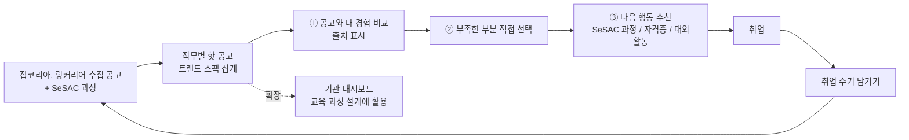
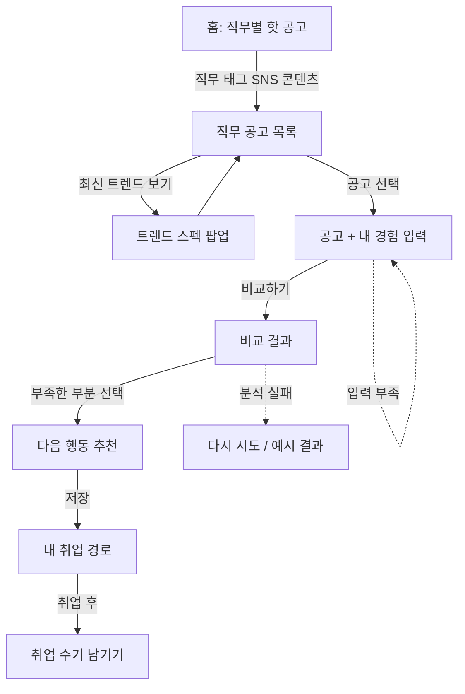

# 서비스 UX 플로우와 와이어프레임 v1

기준: 10/29 팀 회의 결정 · 용도: 10/30 개발 멘토링 공유 (저충실도, 꾸밈 없음)

---

## 0. 회의에서 확정된 것 (설계 전제)

| 항목 | 결정 |
| --- | --- |
| 핵심 기능 3개 | ① 공고와 내 경험 비교 ② 다음 행동 추천 ③ SeSAC 과정 연결 |
| 세부 직무 | SNS 콘텐츠 마케팅 (퍼포먼스 마케팅은 확장 슬라이드) |
| 메인 페르소나 | 학생회 홍보부에서 인스타를 운영해 본 취준생 (발표와 시연은 이 한 명으로) |
| 보조 페르소나 | 재학생(1~3학년), 신입 실무자(이직 준비)는 슬라이드 한 장으로만 |
| 첫 화면 | 이목을 끄는 **직무별 핫 공고** (자격증 순위는 근거가 약해서 제외) |
| 트렌드 스펙 | 직무를 검색하거나 태그를 고르면 볼 수 있음 (팝업, 탭: 자격증 / 교육과정 / 비교과) |
| 개인화 판단 리스크 | AI가 "합격 가능" 판정을 하지 않음. **출처와 집계 수치**를 보여주고, **사용자가 부족한 부분을 직접 고름** |
| 마지막 | 취업 수기 남기기로 선순환 의도 표시 (실제 참여율보다 의도가 중요) |
| 확장 | 기관 대시보드, 커뮤니티 전체, 선배 경험 공유, 퍼포먼스 마케팅 |

캐치프레이즈: **청년의 경험으로, 다음 청년의 기회를**

---

## 1. 경험 목표

- **사용자가 할 수 있어야 하는 것:** 관심 공고 하나를 골라 내 경험과 나란히 보고, 부족한 부분 하나를 스스로 골라, 그걸 채울 다음 행동(특히 SeSAC 과정) 하나를 저장한다
- **성공 기준:** 첫 화면에서 다음 행동 저장까지 **3분 안, 클릭 7번 이내** (잡케어는 재인증 포함 한참 걸리고 결과가 목록 98개)
- **이 서비스가 반드시 분명하게 보여줄 것:** "내 경험이 이 공고의 어떤 요구와 맞고, 어디가 비었는지, 그 근거는 어디서 왔는지"

---

## 2. 파이프라인 (선순환 구조)



발표용 한 줄: **"수집한 공고 데이터에서 시작해, 경험 비교를 거쳐, SeSAC 과정으로 연결되고, 취업한 청년의 수기가 다시 데이터가 된다."**

---

## 3. 사용자 흐름 (메인 페르소나 시연 기준)



---

## 4. 화면 목록 (Screen inventory)

| ID | 화면 | 하는 일 (한 문장) | 주 행동 1개 |
| --- | --- | --- | --- |
| S0 | 홈 | 직무별 핫 공고로 관심을 끌고 직무를 고르게 한다 | 직무 태그 선택 |
| S1 | 직무 공고 목록 | 선택한 직무의 청년 대상 공고를 모아 보여준다 | 공고 하나 선택 |
| P1 | 트렌드 스펙 팝업 | 이 직무 공고들이 실제로 많이 요구하는 것을 출처와 함께 보여준다 | 닫고 공고 보기 |
| S2 | 공고 + 내 경험 입력 | 공고 요건 옆에 내 경험을 적게 한다 | 비교하기 |
| S3 | 비교 결과 | 요건별로 맞는 근거와 빈 곳을 보여주고, 채울 부분을 고르게 한다 | 부족한 부분 선택 |
| S4 | 다음 행동 추천 | 고른 부분을 채울 방법(SeSAC 과정 우선)을 보여준다 | 저장 / 신청하러 가기 |
| S5 | 내 취업 경로 | 저장한 공고, 비교 결과, 다음 행동을 한 곳에 모은다 | (없음, 확인용) |
| S6 | 취업 수기 | 취업 후 경험을 남겨 다음 청년의 데이터가 되게 한다 | 수기 제출 |

시연 2분에 꼭 나오는 화면: **S0, S1(+P1 잠깐), S2, S3, S4**. S5와 S6은 발표 슬라이드로.

---

## 5. 와이어프레임 (저충실도)

> 실제 문구로 작성. 굵은 테두리 버튼 `[■ ...]` 은 주 행동, `[ ... ]` 는 보조 행동.

### S0. 홈

```
┌──────────────────────────────────────────────────────────────┐
│ [로고]                                   직무 찾기   내 경로   │
├──────────────────────────────────────────────────────────────┤
│                                                              │
│  청년의 경험으로, 다음 청년의 기회를                              │
│  관심 직무를 고르면 요즘 공고가 원하는 것과 내 경험을 비교해 드려요   │
│                                                              │
│  ┌──────────────────────────────────────────────┐            │
│  │ 🔍 직무를 검색하세요  예) SNS 콘텐츠 마케터       │            │
│  └──────────────────────────────────────────────┘            │
│  [SNS 콘텐츠 마케팅] [퍼포먼스 마케팅] [브랜드 마케팅] [MD]      │
│                                                              │
├──────────────────────────────────────────────────────────────┤
│  🔥 이번 주 마케팅 직무 핫 공고                  기준: 조회수     │
│                                                              │
│  1  OO코스메틱  SNS 콘텐츠 마케터 (신입)     D-5   조회 1,204  │
│  2  OO교육     콘텐츠 마케팅 인턴           D-12  조회 987    │
│  3  OO푸드     브랜드 SNS 운영 담당          D-3   조회 851    │
│  4  ...                                                      │
│                                                              │
│  [■ 내 취업 경로 찾아보기 ]                                     │
└──────────────────────────────────────────────────────────────┘
```

- 핫 공고 순위 기준은 **조회수** (특정된 데이터라 근거가 분명함). 자격증 순위는 첫 화면에 두지 않음
- `[결정 필요]` 시연 시점에 조회수 데이터가 없으면: 마감 임박순 또는 공고 API의 등록순으로 대체하고 기준 라벨을 바꿀 것

### S1. 직무 공고 목록 (SNS 콘텐츠 마케팅 선택 후)

```
┌──────────────────────────────────────────────────────────────┐
│ ‹ 홈    SNS 콘텐츠 마케팅 공고 128건                            │
├────────────────────────────────────────┬─────────────────────┤
│ 필터: [신입] [서울] [마감 가까운 순 ▾]     │ 📈 이 직무 최신 트렌드  │
│                                        │                     │
│ ┌────────────────────────────────────┐ │ 공고들이 많이 요구하는 것│
│ │ OO코스메틱  SNS 콘텐츠 마케터 (신입)  │ │ · 콘텐츠 기획 51%     │
│ │ 서울 · D-5 · 우대: SNS 채널 운영 경험 │ │ · 영상, 숏폼 40%      │
│ └────────────────────────────────────┘ │                     │
│ ┌────────────────────────────────────┐ │ [ 트렌드 자세히 보기 ]  │
│ │ OO교육  콘텐츠 마케팅 인턴             │ │                     │
│ │ 서울 · D-12 · 우대: 릴스 편집 가능     │ │ 출처: SNS 콘텐츠      │
│ └────────────────────────────────────┘ │ 공고 104건 (10월)     │
│ ...                                    │                     │
└────────────────────────────────────────┴─────────────────────┘
```

- 모바일에서는 오른쪽 트렌드 카드가 목록 위에 접힌 배너로 올라감

### P1. 트렌드 스펙 팝업

```
┌─────────────────────────────────────────────┐
│ SNS 콘텐츠 마케팅 최신 트렌드              ✕   │
│ [자격증] [교육과정] [비교과]                   │
├─────────────────────────────────────────────┤
│ 교육과정 탭                                   │
│                                             │
│ 공고에서 많이 언급한 역량                       │
│ 콘텐츠 기획                     ████████ 51%   │
│ 영상, 숏폼 제작                  ██████   40%   │
│ 디자인 툴 (캔바, 포토샵)        █████    37%   │
│ 포트폴리오                     █████    36%   │
│ 자격증                         ▏        3%    │
│                                             │
│ 이 역량을 다루는 SeSAC 과정 2개  [ 보기 ]       │
│                                             │
│ 출처: SNS 콘텐츠 마케팅 공고 104건, 2026.10  │
└─────────────────────────────────────────────┘
```

- 모든 수치에 **출처와 기준 시점**을 붙임 (개인화 판단 리스크를 줄이는 장치)

### S2. 공고 + 내 경험 입력

```
┌──────────────────────────────────────────────────────────────┐
│ ‹ 목록   OO코스메틱 · SNS 콘텐츠 마케터 (신입)                   │
├──────────────────────────────┬───────────────────────────────┤
│ 이 공고가 원하는 것             │ 내 경험                         │
│                              │                               │
│ 필수                          │ 전공  [미디어커뮤니케이션학과   ]    │
│ · 인스타그램 채널 운영 경험      │ 자격증 [컴활 2급 ×] [+ 추가]       │
│ · 콘텐츠 기획, 제작              │ 어학  [OPIc IM2 ×] [+ 추가]       │
│                              │                               │
│ 우대                          │ 활동과 프로젝트                   │
│ · 릴스, 숏폼 편집 가능           │ ┌───────────────────────────┐ │
│ · 성과 지표 분석 경험            │ │ 학생회 홍보부 인스타 운영 1년   │ │
│ · 디자인 툴 활용                 │ │ 카드뉴스 주 1회 제작 (캔바)    │ │
│                              │ │ 팔로워 300명에서 1,200명       │ │
│ 원문 공고 보기 ↗                 │ └───────────────────────────┘ │
│                              │ [ 예시로 채우기 ]                 │
│                              │                               │
│                              │ [■ 비교하기 ]                    │
│                              │ 입력한 내용은 저장하지 않아요        │
└──────────────────────────────┴───────────────────────────────┘
```

- 공고 요건은 공고 원문에서 자동 추출 (`[결정 필요]` 시연에서는 텍스트 붙여넣기 방식이 안정적인지 개발 멘토에게 확인)
- "예시로 채우기" 버튼: 시연에서 타이핑 없이 페르소나 입력이 들어감

### S3. 비교 결과

```
┌──────────────────────────────────────────────────────────────┐
│ ‹ 입력 수정   비교 결과 · OO코스메틱 SNS 콘텐츠 마케터             │
├──────────────────────────────────────────────────────────────┤
│ 공고 요구 6개 중 내 경험과 연결되는 것 3개                        │
│                                                              │
│ ✅ 인스타그램 채널 운영 경험                                     │
│    공고: "인스타그램 채널 운영 경험자"                            │
│    내 경험: "학생회 홍보부 인스타 운영 1년, 팔로워 300명에서 1,200명"│
│                                                              │
│ ✅ 디자인 툴 활용                                               │
│    공고: "디자인 툴 활용 가능자 우대"  내 경험: "캔바로 카드뉴스 제작" │
│                                                              │
│ ⚠️ 콘텐츠 기획      경험은 있지만 기획 과정이 드러나는 자료가 없음     │
│ ⬜ 릴스, 숏폼 편집   입력한 경험에서 찾지 못함                      │
│ ⬜ 성과 지표 분석    입력한 경험에서 찾지 못함                      │
│                                                              │
│ 참고: SNS 콘텐츠 공고 104건 중 "영상, 숏폼 제작" 언급 40%     │
│ 판정은 공고 문장과 입력 문장 비교 결과이며, 합격 여부 예측이 아니에요   │
├──────────────────────────────────────────────────────────────┤
│ 어느 부분을 먼저 채우고 싶으세요?                                 │
│ [ 교육으로 배우기 ] [ 자격증·어학 ] [ 대외활동·프로젝트 ] [ 지원 준비 ]│
└──────────────────────────────────────────────────────────────┘
```

- **AI가 "지원하세요 / 하지 마세요"를 판정하지 않음.** 근거 문장 두 개를 나란히 보여주고 사용자가 고름 (멘토님 리스크 지적 반영)
- ❌ 대신 ⬜ "찾지 못함"을 사용: "부족하다"는 단정 대신 "입력에서 못 찾았다"는 사실만 말함

### S4. 다음 행동 추천 ("교육으로 배우기" 선택 시)

```
┌──────────────────────────────────────────────────────────────┐
│ ‹ 비교 결과   릴스, 숏폼 편집을 채울 수 있는 방법                   │
├──────────────────────────────────────────────────────────────┤
│ SeSAC 과정                                                    │
│ ┌──────────────────────────────────────────────────────────┐ │
│ │ OO캠퍼스 · 숏폼 콘텐츠 마케팅 실무   무료 · 8주 · 11/17 개강    │ │
│ │ 다루는 역량: 릴스 편집, 콘텐츠 기획, 성과 분석                  │ │
│ │ 이 공고의 빈 곳 3개 중 2개와 연결                              │ │
│ │ [■ 신청 페이지로 가기 ↗ ]   [ 내 경로에 저장 ]                 │ │
│ └──────────────────────────────────────────────────────────┘ │
│ ┌──────────────────────────────────────────────────────────┐ │
│ │ OO캠퍼스 · 디지털 마케팅 기초   무료 · 6주                      │ │
│ │ 이 공고의 빈 곳 3개 중 1개와 연결   [ 신청 ↗ ] [ 저장 ]          │ │
│ └──────────────────────────────────────────────────────────┘ │
│                                                              │
│ 다른 방법도 보기  [ 자격증·어학 ] [ 대외활동·프로젝트 ]              │
│ 출처: SeSAC 과정 정보 (2026.10 기준)                             │
└──────────────────────────────────────────────────────────────┘
```

선택별 결과 내용:

| 선택 | 보여주는 것 |
| --- | --- |
| 교육으로 배우기 | SeSAC 과정 우선, 빈 곳과 연결되는 개수 표시 |
| 자격증·어학 | 이 직무 공고에서 요구한 비율이 높은 순 (예: 운전면허처럼 직무와 무관한 건 제외 규칙 필요 `[결정 필요]`) |
| 대외활동·프로젝트 | 공모전, 서포터즈, 개인 채널 운영 프로젝트 예시 |
| 지원 준비 | 원문 공고 바로가기 + 제출 전 체크리스트 (포트폴리오에 성과 수치 넣기 등) |

### S5. 내 취업 경로 / S6. 취업 수기 (슬라이드용)

```
┌────────────────────────────────────┐   ┌────────────────────────────────────┐
│ 내 취업 경로                         │   │ 취업 수기 남기기                      │
│                                    │   │ 다음 청년에게 도움이 돼요               │
│ 목표 공고 OO코스메틱 SNS 마케터        │   │                                    │
│ 연결된 경험 3 / 6                    │   │ 합격한 직무 [SNS 콘텐츠 마케터 ▾]       │
│ 다음 행동 SeSAC 숏폼 과정 (11/17)     │   │ 도움된 경험 [                    ]   │
│                                    │   │ 도움된 과정 [SeSAC 숏폼 과정 ▾]       │
│ [ 다른 공고와도 비교하기 ]             │   │ [■ 수기 남기기 ]                      │
└────────────────────────────────────┘   └────────────────────────────────────┘
```

---

## 6. 상태 (State) 점검

| 화면 | 로딩 | 비어 있음 | 오류 | 기타 |
| --- | --- | --- | --- | --- |
| S0 홈 | 핫 공고 스켈레톤 3줄 | "이번 주 집계 중이에요" + 직무 태그는 그대로 | 공고 API 실패 시 저장된 지난주 목록 + 기준일 표시 | |
| S1 목록 | 카드 스켈레톤 | "조건에 맞는 공고가 없어요" + 필터 풀기 버튼 | 다시 시도 | |
| S2 입력 | | 활동 칸 비면 비교하기 비활성 + "활동을 한 줄 이상 적어 주세요" | | 입력 유지 (뒤로 가도 사라지지 않음) |
| S3 비교 | "공고 요구와 경험을 비교하는 중" 진행 표시 (수 초) | 연결 0개일 때도 결과 표시 + "교육으로 배우기"를 먼저 보여줌 | 분석 실패 시 다시 시도, **입력 내용 유지** | |
| S4 추천 | 카드 스켈레톤 | 맞는 SeSAC 과정이 없으면 "지금 모집 중인 과정이 없어요" + 다음 모집 알림 / 다른 방법 | 외부 링크 실패 시 과정명과 문의처 표시 | |

---

## 7. 화면 원칙 (꾸밈 최소)

- 화면마다 **주 행동 1개**만 강조색. 나머지는 테두리 버튼
- 숫자와 판정에는 항상 **출처, 기준 시점** 표시
- 판정 표현은 "맞음 / 일부 / 찾지 못함". "부족", "불합격", "합격 가능" 같은 단정 표현은 쓰지 않음
- 입력 칸 글자 크기 16px 이상 (모바일 확대 방지), 버튼 높이 44px 이상

---

## 8. 내일 개발 멘토링에서 확인할 것 `[결정 필요]`

1. 공고 요건 추출: 공고 URL 크롤링 vs 텍스트 붙여넣기. 시연 안정성은?
2. 공고 문장과 경험 문장 비교: LLM으로 근거 문장을 안정적으로 뽑는 방법 (프롬프트, 구조화 출력)
3. 핫 공고 조회수: 우리 사이트 조회수가 없는 시연 단계에서 대체 지표는?
4. SeSAC 과정 데이터: 공개 API가 없으면 수동 수집한 목록으로 충분한지
5. 11/6까지 S0~S4만 동작하게 만들고 S5, S6은 화면만 두는 범위가 현실적인지

---

## 가정과 남은 결정

- **가정:** 데이터 출처는 잡코리아 공고 7,701건과 링커리어 공고 459건, SeSAC 과정 210개 수동 수집 (고용24 API는 개인회원 사용 불가). 수치는 SNS 콘텐츠 마케팅 공고 104건 중 본문 언급 비율(콘텐츠 기획 51%, 영상과 숏폼 40%, 디자인 툴 37%, 포트폴리오 36%, 자격증 3%)이고 화면의 공고와 과정명은 예시
- **가정:** 웹 반응형, 데스크톱 시연 기준 (모바일은 2단 레이아웃이 1단으로)
- **남은 결정:** 핫 공고 기준 지표, 공고 입력 방식, 자격증 추천에서 직무 무관 항목 제외 규칙, 연결 개수 표시 방식이 "점수처럼" 보이지 않는지 (멘토 피드백 필요)
- **검증 안 됨:** 실제 사용자 테스트 없음 `[heuristic]`. 시연 전 팀원 1~2명에게 S2부터 S4까지 직접 눌러보게 해서 막히는 곳 확인 권장
